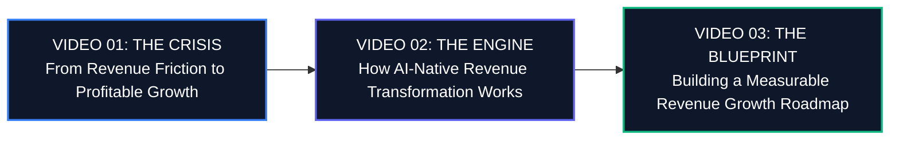

# Series Strategy: ProfitMachines Executive YouTube Series

## 1. Strategic Context & Vision

### The Executive Market Reality
Enterprise software and B2B commercial organizations are navigating an unprecedented structural transition. The era of cheap capital, brute-force headcount expansion, and indiscriminate software tool stacking has collapsed under soaring customer acquisition costs (CAC), expanding buying committees (6–10 stakeholders), and severe pipeline slippage (67% of forecasted deals slipping past target quarters).

Executive leaders are overwhelmed by generic AI hype and empty chatbot demos. They do not need another generic content writer; they require **capital-efficient revenue infrastructure** that solves the core bottlenecks of sales execution: lead decay, fragmented CRM data, low rep productivity, and erratic forecasting.

### Series Objective
This 3-part YouTube video series positions **ProfitMachines** as the premier, mathematically auditable, AI-native revenue transformation platform. It establishes an intellectual and operational bridge between macroeconomic pressure and practical, deterministic revenue engineering.

---

## 2. Audience Segmentation & Mindset

| Persona | Core Pain Point | What They Care About | Intended Shift in Belief |
| :--- | :--- | :--- | :--- |
| **Chief Revenue Officer (CRO)** | Quota misses, rep burnout, 70-day+ sales cycle drag, low win-rates | Predictable sales velocity, rep productivity, deal qualification rigor | "Adding more reps is broken. Connected revenue intelligence accelerates closing without expanding headcount." |
| **Chief Financial Officer (CFO)** | Escalating CAC payback periods (>24 months), tech stack bloat, unvalidated ROI | Contribution margin, capital efficiency, Rule of 40, auditable forecasting | "Revenue operations is an engineering discipline with quantifiable NPV and verifiable payback." |
| **Chief Executive Officer (CEO)** | Stalled enterprise valuation, board scrutiny, unpredictable growth forecasts | Sustainable enterprise growth, compounding Net Revenue Retention (NRR) | "AI-native GTM transformation is a strategic moat, not just a software tool purchase." |
| **VP of Revenue Operations** | Fragmented data silos, manual CRM updates, tool sprawl, dirty data | Automated data synchronization, universal entity resolution, clean handoffs | "A unified revenue fabric eliminates 14 hours of rep data drag every week." |

---

## 3. Narrative Architecture Across the Trilogy

### Video 1: "From Revenue Friction to Profitable Growth" (The Problem)
* **Goal:** Diagnose the macro-shift and expose the hidden systemic breakdowns causing revenue leakage.
* **Tone:** Diagnostic, objective, eye-opening, analytical.
* **Takeaway:** Your revenue engine isn't suffering from poor effort; it is suffering from architectural friction.

### Video 2: "How AI-Native Revenue Transformation Works" (The Approach)
* **Goal:** Demystify how autonomous revenue intelligence genuinely functions across the full lifecycle—from profit pool discovery to AI trust.
* **Tone:** Technical, elegant, systemic, authoritative.
* **Takeaway:** Revenue acceleration requires a synchronized 8-part capability fabric, not isolated point tools.

### Video 3: "Building a Measurable Revenue Growth Roadmap" (The Execution)
* **Goal:** Provide a practical, low-risk implementation blueprint for diagnosing friction, prioritizing levers, and aligning with the CFO.
* **Tone:** Pragmatic, structured, empowering, CFO-aligned.
* **Takeaway:** Predictable revenue transformation is achievable in a disciplined 90-day phased roadmap.

---

## 4. Visual Language & Production Standards

* **Palette:** Executive Slate-950/900 dark backdrops, deep navy, electric blue accents (`#2563EB` / `#3B82F6`), subtle emerald green indicators for financial yield, and crisp white typography.
* **Visual Style:**
  - Clean animated motion graphics (system diagrams, waterfall charts, pipeline flow visualizers).
  - High-contrast typography with data callouts and financial equations.
  - Zero generic B-roll stock footage of business people laughing over laptops or shaking hands in glass lobbies.
  - Authentic UI walkthroughs, flowcharts, and empirical benchmark visualizations.
* **Delivery Tone:**
  - Measured, executive, authoritative pacing.
  - No hyperbolic clickbait hooks or breathless YouTuber cadence.
  - Grounded in Harvard Business Review, Gartner, McKinsey, and MIT Sloan research terminology.

---

## 5. Conversion & Funnel Integration

Every video includes a unified strategic call to action (CTA):
1. **Primary Lead Magnet:** Download the 57-page executive eBook: *“From Revenue Friction to Profitable Growth”*.
2. **Secondary Engagement:** Schedule a confidential 45-minute Executive Commercial Diagnostic under mutual NDA at `https://profit-max-delta.vercel.app/book-consultation`.
3. **Contact Inquiries:** Connect directly with the Principal Architecture Advisory team at `connect@trustgrid.ai`.

